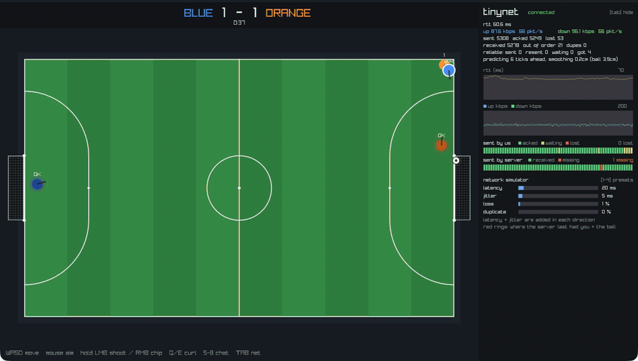
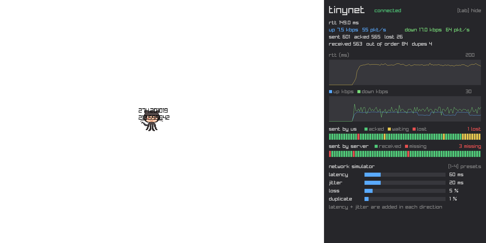
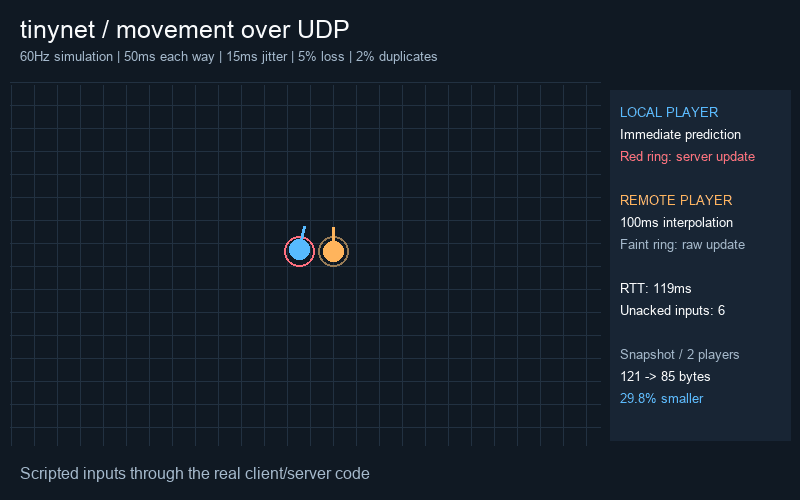

# A Low-Latency C++ Multiplayer Server & Protocol

...and now a tiny football game on top of it.

I was writing the netcode for a Unity game I was making with my friends, when I realized that I do not have a very good grasp of how networking actually works.

So, I decided to build tinynet! This project is just for my enjoyment of recreational programming and to broaden my understanding of the topic, so I've avoided using LLMs. While an extraordinarily useful tool, I find that I learn best when I write the code myself.

Update: I've since started using AI (Claude) to help brainstorm new features and explain networking architecture to me. To be upfront about where the line is, Claude also wrote the code for the packet timeout fix, heartbeats, the network simulator, connection stats and the net debug overlay, plus the design log entries about them further down (marked _(written with Claude)_). Codex also wrote the movement simulation, prediction, interpolation, snapshot compression, the scripted GIF demo and their tests (the entries below say so). Later, Claude wrote the football game on top (ball physics, kicking, the match rules, AI keepers, bots, the client's rendering and HUD), the reliable message channel, disconnect packets, ball prediction and the fix for sequence number 0, along with their tests and the design log entries about them. Everything else I wrote by hand.

I attribute most of my work to a few different sources, with the most prominent (while this project is still in its infancy) being Glenn Fiedler's [Game Networking series](https://gafferongames.com/categories/game-networking/).

Note that:
client/ is the game's rendering, input and hud, plus the net debug overlay
common/ is networking generics; knows nothing about the game
server/ is the authoritative match, the keepers, and the server rules
shared/ is game-specific code needed by both client and server: physics, prediction, the wire format

---

Features so far:

- Custom UDP Socket & Address abstraction (non-blocking POSIX socket, cross platform)
- Binary Serialization Engine (endian-safe)
- 16-Byte Protocol Packet Header (protocol hash, sequence ID, remote ack, 32-bit ACK bitfield)
- Reliability & ACK System (ring buffers for packet queues)
- Connection Lifecycle (Heartbeat, timeout detection, event loops and such)
- Network Condition Simulator (latency, jitter, loss, duplication; sits under the socket so nothing above it knows it's fake)
- Connection Stats (packets/bytes in & out, acked, lost, duplicates, out of order, smoothed RTT)
- Quantized snapshots (centimetre positions, 32-bit smallest-three quaternions; 33.2% smaller with 10 players)
- Client-side prediction + reconciliation, remote position/rotation interpolation 100ms behind estimated server time
- Fixed 60Hz movement simulation (shared Vec3/Quat math, acceleration, friction, server input sequencing)
- Live Net Debug Overlay in the demo (RTT + bandwidth graphs, per-packet ack strips, simulator sliders & presets)
- Reliable, ordered messages piggybacked on normal packets (resent until a packet carrying them is acked; no heap, no extra packets)
- Immediate disconnects both ways, including Ctrl+C on either end, instead of waiting out the 10 second timeout
- A small playable football (futsal) match: two minute games, AI goalkeepers, goals, kickoffs and a score/clock/event HUD
- Ball physics shared by the server and client: gravity, drag, bounces, rolling friction, sidespin curl, and a goal frame you can hit
- Charged ground shots, chips and curled shots; dribbling by running into the ball
- Client-side ball prediction, so your own touches and kicks happen instantly, with smoothed corrections and a timeframe blend for contested balls
- Bots that play through the same inputs a person makes (`--bot`), and a soak test that runs a match of them over a bad network

The GIF records two actual UDP clients with 50ms latency each way, 15ms jitter, 5% loss and 2% duplication. Blue is the local predicted player; orange is the remote interpolated player. The red ring is the last authoritative position for blue, and the faint orange ring is the latest unsmoothed remote update. Inputs are scripted, then released to show friction. A small Python renderer draws the recorded simulation states.

To regenerate it: `make demo` (Python 3 with Pillow; uses local UDP ports 40100-40102 for about 12 seconds). `make snapshot-size` reruns the serialization measurements without opening a window.

Running it: `make server client`, then `make run-server` and `make run-client PORT=3001`. Each extra client needs its own port; `make run-bot PORT=3002` adds a computer-controlled opponent, and `./client/bin/client 3003 --bot --preset 3` starts one on the mobile network preset.

In the client, WASD moves you around the pitch and you face the mouse. Hold the left mouse button to wind up a shot and let go to kick (a quick tap is a pass); the right button does the same for a chip. Hold Q or E while you kick to curl it left or right; the dotted line shows where it'll go. 5-8 are quick chat, TAB toggles the overlay, 1-4 are network presets (perfect / decent wifi / mobile / awful), and the sliders cover anything in between.

The GIF at the top is two `--bot` clients on the decent wifi and mobile presets; the frames are captured straight from one client's window.

`make test` builds and runs everything in tests/. A few of them run whole matches over real UDP through the network simulator, so the full run takes a bit over a minute.

---

I wanted to add a little section here (mostly for myself) to document some of the decisions I've made on this project and why.

- !

_UDP vs TCP_ is likely something that you may have been wondering about. I opted for UDP here for a couple of reasons.

First of all, UDP is _fast_. We aren't really getting any blocking loops and are able to transmit data at speeds much quicker than TCP. We don't have to concern ourselves with handshakes, we send entire packets at once rather than in segments, and we don't have to wait to acknowledge that the client and server have both fully sent/received packets. As with all things, of course, this comes with a few large tradeoffs. Data can be unreliable, out of order, UDP's checksum can also be unreliable - and so on. However, this project is meant to be as high performance as possible, and TCP simply loses to UDP on that front.

Also, UDP gives me a bit more intimate control over the way that I handle my data. Because of the unstructured nature of the protocol, I can choose how to break up my packets, serialize, deseralize, and so on. I like knowing that I have the low level control over the happenings in my code.

- !

_Packet Integration_! As I write this, I'm at the stage of reading, writing, bitpacking, serializing, etc. all of my packets. When considering how we should be treating packets, I initially thought OOP would be a good choice, as it allows for some clean polymorphism. However, as you begin to think about the scale of your packets, this quickly becomes undesirable from a memory perspective. Deserializing a packet in this case would likely require some heap allocation, which, in a 60+ FPS tick loop with hundreds of packets per frame, will likely fragment the heap (alongside GC overhead) and I have little desire to write a custom pool allocator at the moment.

Right now, the raw data is passed around via the _Buffer_ struct (currently and likely for the forseeable future under clinet/Packets.h). This decouples the logic from Socket, Client, Server, and other relevant networking classes, is inline friendly, and allocates nothing on the heap. It's not amazing to work with from a developer standpoint, though std::variant is an attractive option here.

On a more fundamental level, I need to decide what the job of each layer (Socket/Server, Game Logic, and so on) is. Does Socket want to care if its reading a PlayerInputPacket, or just a buffer? This will take a little more thinking on my end, and I still haven't come to a full conclusion :)

Jaden from a couple hours later here. I think I'm happy with the design I've set out for; we pass around buffers of data, which are prepended with our protocol hash on send and receive. It's important to note that we're working on a byte-by-byte level here; later down the line, an optimization I'm looking to make would be turning this to a bit-by-bit abstraction. It's not particularly relevant unless we're working with massive streams of data, but I do want this to be a _high performance_ project, so it is certainly something on the todo list.

- !
  _Acks_ confused me for a bit here. todo later finish this; but some thoughts before i forget: let's say we're the server, and are about to send a packet to the client. we look at our sequence number. we put that in the packet header. then, we look at
  our received queue for n - 32 and put them all as ack'd in our ack bitfield, which we place in the header. the client receives this packet, looks at their sent queue, and then acks each of the ones we received in the header, takes them off the sent queue, and then resends if a packet hasn't been acked yet newer ones have been

- !
  We have a working prototype! What a satisfying feeling. The next step for me is going to be the transportation layer. We have a solid way to create Client and Server abstractions, which are built on top of our custom Connections, which are built on our custom Socket, all with some nice magical protocol hashing, RTT calculations, acks, and the likes. For a few days and a bit of thinking, this has been an amazing project for me. But, rambling aside, back to the transportation layer. Currently, the client and server can send packets back and forth and all is well, but if we want a server-authoritative system, the client should be sending requests to manipulate data, while server sends back world snapshots. Later down the line I plan on optimizing this a bit further with a system similar to our ACK bitfield, but instead with world snapshot deltas. Nevertheless, I worry about how we are going to (cleanly) apply data read from incoming packets into the gamestate. For example, if the player receives a WorldState packet containing its position, how do we send that back up? I'm thinking some sort of message queue x polling system, where the main game polls from a queue of pending packets, and processes packets depending on how we've handled them. I'll see if I can get that going ASAP.

- !
  _Faking a bad network_ _(written with Claude)_. Over localhost nothing ever goes wrong: no loss, no reordering, and RTT is basically however long our sleep()s are. That makes it really hard to tell if acks and loss detection actually work, so there's now a NetworkSimulator that adds latency, jitter, loss and duplication.

  It sits _under_ the Socket, not in Connection or the game. Socket::Send and Socket::Receive hand packets to the simulator, which holds onto them until their delay is up (or just drops them). Everything above it (acks, RTT, the replication systems) has no idea, which is the whole point: we're testing the real code path, not some special debug one. The server never turns it on; the client simulates both directions so one set of sliders controls the whole round trip. That also means latency is added _each way_, so 50ms on the slider is ~100ms of RTT.

  Jitter gives every packet its own random delay, so packets overtake each other for free, which is where the out of order counter gets its numbers. It does heap allocate per packet, which goes against the whole Buffer thing from earlier, but it's a debug tool that's off by default, so the real path never touches it.

  Something worth knowing: the simulator can only hand a packet over when someone polls the socket. Polling every 1ms, measured RTT comes out at 2x the simulated latency + ~4ms (53.6ms for 25ms each way, 203.9ms for 100ms). In the demo, where both sides poll once per ~16ms tick, there's already ~30-40ms of RTT with the simulator off. That's all tick scheduling, not the network, which is good to know before blaming the network for anything.

- !
  _When is a packet actually lost?_ _(written with Claude)_. With acks piggybacked on every packet, nobody ever says "didn't get 41". We only find out what _did_ arrive, through the ack + 32-bit bitfield. So the earliest we can honestly call a packet lost is once the newest ack is more than 32 packets ahead of it, because from then on no header can ever ack it again. At ~60 packets a second that's about half a second after sending. That's the yellow "waiting" run on the right of the overlay's strip; a yellow cell further left is one we just don't know about yet.

  SentQueue now keeps track of the highest ack it's seen and sweeps everything that falls out of the window, so each packet gets counted exactly once. It also ignores acks for sequence numbers we never sent, since anyone can put anything in a header. With the simulator at 5/10/25% loss for 10 seconds (~600 packets), measured loss came out at 4.0/9.1/24.1% outgoing and 3.7/10.6/25.5% incoming, which is about as close as you'd expect from ~600 coin flips.

  This only works if packets keep flowing, which is why the client sends a Heartbeat when it has no input now. Before that, an idle client sent nothing at all, so RTT froze and the server would've marked us as timed out after 10 seconds.

- !
  _Counters, not rates_ _(written with Claude)_. Connection only keeps running totals (packets and bytes sent/received, acked, lost, and so on). Anything per second, like kbps, is worked out by the overlay, which samples the totals every 100ms and diffs them. That keeps common/ cheap (a few increments per packet) and lets whoever's reading choose their own window. The overlay is also the only thing that knows raylib exists; common/ just answers questions like "what happened to packet 512?", so the networking stays reusable outside this demo. The sliders are immediate mode: every frame the slider draws itself and returns the new value, so there are no slider objects to keep in sync.

  Some numbers at this stage (before the movement/rotation snapshots below):
  - 16 byte header per packet. A world snapshot with one player is 33 bytes (16 header + 1 type + 4 player count + 12 per player), so ~16 kbps down per client at 60Hz, before UDP/IP's 28 bytes per packet.
  - A snapshot fits in one 1400 byte packet up to 114 players. After that we need splitting, interest management, or deltas.
  - RTT measurement lines up with simulated latency within ~4ms when polled every 1ms.
  - Measured loss matches simulated loss within ~1.5 percentage points at 5-25%.

  Things the overlay shows that need fixing: turn up duplicate and you move faster, because duplicated input packets get applied twice. Turn up jitter and players rubber-band, because a late snapshot overwrites a newer one. Those were the symptoms at the time. Movement now deduplicates numbered inputs, and snapshot history ignores old ticks, so late packets can still contribute their transport ACKs without moving the world backwards.

- !
  _Actually simulating movement_ _(written with Codex)_. Before this, moving meant adding a little bit to your position every time an input packet arrived. That means more packets = more movement, which is a slightly unfortunate way to handle duplicates :) The server now steps at 60Hz, and each numbered input describes one of those steps. Missing inputs get resent (that player waits at the gap), duplicates are ignored, and the server says which input it actually processed in the snapshot. The packet ACK still means "received this packet"; the input ACK means "used this movement command".

  There is now a small Vec3/Quat header in shared/, with dot, cross, normalize, lerp, slerp and quaternion-vector rotation. We still draw the demo from above, but its positions and rotations are three-dimensional. A vector is just three numbers describing a direction or position. Normalizing it gives it length 1, so holding W+D doesn't make you faster than just W. The quaternion rotates that input from "forward relative to me" into a direction in the world.

  The actual integration is semi-implicit Euler: first $v_{t+1} = v_t + a\Delta t$, then $x_{t+1} = x_t + v_{t+1}\Delta t$. We use the new velocity to move, then clamp speed and subtract friction. Here $\Delta t = 1/60$ seconds, regardless of how fast the window draws. Releasing the keys still sends a neutral command, so the server knows to coast to a stop. Positions stay inside a world from -100 to 100 on each axis.

- !
  _Waiting a little to look smoother_ _(written with Codex)_. Other players now render about 100ms behind our estimate of server time. It sounds backwards to deliberately add delay, but it means we usually have an update on either side of the moment we're drawing. If those positions are $p_0$ and $p_1$, we draw $(1-\alpha)p_0 + \alpha p_1$, where $\alpha = (t_{render}-t_0)/(t_1-t_0)$. Halfway between the two timestamps? Halfway between the two positions. Rotations use slerp, which follows the shorter arc between unit quaternions instead of cutting straight through them.

  Your own player doesn't wait. The client runs the same movement function immediately and keeps the inputs the server hasn't processed yet. When a snapshot comes back, we reset to that authoritative position AND velocity, discard inputs through its input ACK, then replay the rest. The red ring in the demo is the last position the server sent; the filled circle is where you predict yourself to be now. That gap under latency is expected, not automatically an error.

  This is still a small demo: the remote clock uses half the smoothed RTT as an estimate of transit time, and missing bracketing snapshots hold the nearest available state. There's no extrapolation. The pending input queue caps at two seconds; if the server stops acknowledging, prediction pauses rather than forgetting commands it needs to replay.

- !
  _Sending fewer numbers_ _(written with Codex)_. A quaternion has four components, but if it's normalized, their squares add up to 1. So we can drop the component with the largest absolute value and reconstruct it with $q_{dropped} = \sqrt{1-q_a^2-q_b^2-q_c^2}$. We flip the whole quaternion if that component is negative first; $q$ and $-q$ describe the same rotation, so we don't need to send a sign bit.

  The other three components fit in $[-1/\sqrt{2}, 1/\sqrt{2}]$. Each gets 10 bits, and the dropped component's index gets 2, giving us a 32-bit rotation instead of four 32-bit floats. Positions are signed 16-bit centimetres within our -100 to 100 world, so each axis loses at most half a centimetre to rounding. Velocity stays as floats because it's part of the state we replay for prediction.

  I wanted an actual number here rather than "this should be smaller", so `make snapshot-size` serializes the same player states both ways. These include our 16-byte protocol header, but exclude UDP/IP overhead:

  | Players | Float snapshot | Quantized snapshot | Reduction |
  | --- | ---: | ---: | ---: |
  | 1 | 111 bytes | 87 bytes | 21.6% |
  | 10 | 561 bytes | 375 bytes | 33.2% |
  | 24 | 1261 bytes | 823 bytes | 34.7% |

  _(These were re-measured once the game existed: snapshots now also carry the ball, the score and clock, and each player's team and kick cooldown, and every packet has one more header byte for reliable messages. Originally: 73/55, 505/325 and 1177/745 bytes.)_

  This comparison includes the new position, velocity, rotation and input ACK fields in BOTH formats. The old 2D snapshot was smaller because it didn't contain all that state. These are snapshot savings, not a claim that total traffic fell by the same amount; resending unprocessed inputs costs upstream bytes. Tests cover 10,000 seeded rotations (under 0.35 degrees of angular error), world bounds, truncated packets and invalid values. The protocol hash changed, so old clients won't connect to the new server.

  For now the demo caps at 24 players (22 people + the two keepers) so either snapshot format fits one datagram. Splitting snapshots, delta compression and interest management can wait until there's a reason to add them.

- !
  _Messages that have to arrive_ _(written with Claude)_. Snapshots don't need to be reliable: if one gets lost, a newer one turns up 16ms later. But "GOAL!" or "player 3 joined" only ever happens once. A second TCP connection would bring back the head-of-line blocking we picked UDP to avoid, so instead these ride along on packets we're already sending. After the header, every packet has a small message section: a count, then `[u16 id][u8 size][bytes]` per message.

  A message stays queued until a packet that carried it gets acked. We already know which packets were acked from the ack bitfield, so the channel just remembers which message ids went out in which packet (a ring buffer indexed by sequence number, like SentQueue). Anything unacked after max(100ms, 1.25 × RTT) gets resent in whatever packet goes next. The receiver hands messages out in id order, holds onto early ones, and throws away ones it's already delivered. It's all fixed-size ring buffers, so it costs one byte per packet when there's nothing to say, and ids wrap at 16 bits (tested past 65536).

  The lossy test turned up a bug that predates this. A header acks the newest packet it's received, and there's no "nothing yet" flag, so before you've heard from the other side your header says "ack 0". That acked our packet 0 whether or not it arrived. Before, that just meant one bogus RTT sample. With messages it meant anything in packet 0 was never resent, and the receiver waited for message 0 forever: the test failed about half the time at 25% loss. Sequence numbers now start at 1, so 0 means nothing. Since then: 300/300 messages, in order, exactly once, through 25% loss and 10% duplication.

- !
  _State vs events_ _(written with Claude)_. The score, clock and match phase are state: they're in every snapshot, so a lost packet or someone joining halfway through doesn't matter. Goals, joins, leaves, full time and quick chat are events: one 9 byte reliable message each. The goal banner shows while the snapshot says we're in the goal pause, and its text comes from the event.

  The server never trusts a client about who said something. Quick chat gets the sender's id from the connection, not the message, and is limited to twice a second. (The first version of that limit had a unit test catch `tick - lastChatTick` wrapping around before the first tick.) Leaving works the same way in both directions: send "i'm leaving" three times, since nobody's around afterwards to resend it, and the other side forgets you immediately. Ctrl+C on the server or a client does it too. Any late packets from that address look like a stranger who never asked to connect, and get dropped.

  Playing against bots turned up one rules bug: a shot that clipped the keeper on its way in counted as an own goal. Now, if the scoring team took a shot in the last 1.5 seconds and a defender got the last touch, the goal is the shooter's.

- !
  _A ball that behaves_ _(written with Claude)_. The ball uses the same semi-implicit Euler as players, plus gravity, drag, bounces and friction. Drag is `v *= exp(-k dt)` rather than `v *= 1 - k dt`, so it slows down the same amount per second whatever the tick rate. To check it, a ball kicked straight up has a closed form: it peaks at $h = v_0/k - (g/k^2)\ln(1 + kv_0/g)$, and the simulation lands within $v_0\Delta t$ of that (stepping in ticks costs about half a tick of height).

  Curl is the Magnus effect: spin pushes the ball sideways, at right angles to where it's going. A force at right angles changes the direction but not the speed, so instead of adding an acceleration it rotates the velocity by `Yaw(c · spin · dt)`, the same quaternion players turn with. With constant spin the ball flies a circular arc, and its speed comes out identical with and without spin (tested).

  The posts and crossbar are cylinders around line segments. The closest point on a segment is "project onto it, clamp to the ends", and a bounce only flips the part of the velocity heading into the bar: $v \leftarrow v - (1+e)(v \cdot n)n$. That gets you shots off the post, off the bar, and off the underside of the bar and in. A goal needs the whole ball over the line, like the real rule. Kicking checks the ball is within 75° of where you face with a dot product: the dot of two unit vectors is the cosine of the angle between them. Power and curl go over the wire as bytes and get stored as bytes too, so the client predicts with exactly the numbers the server will use.

- !
  _Keepers_ _(written with Claude)_. Each team has a keeper the server plays. It goes through the same input → SimulateMovement path as everyone else, so clients can't tell it from a person. It stands on the bisector of the angle between the ball and the two posts. Add the unit vectors from the ball to each post and you get a direction that's the same angle from both, then follow it until it hits the keeper's line by solving $b_x + t\,d_x = x_{keeper}$. When a shot's coming, it runs the real ball physics forward to see where it'll cross. It does that with the spin zeroed out, so it reads the line of a shot but not the curl: a curler that looks like it's going wide and bends inside the post fools it. It also sees the ball 250ms late.

  I tuned it by measuring rather than guessing. The first shooting gallery said it saved 93% of shots, and slowing its reactions made almost no difference, which was suspicious. The test was starting the ball already moving, so the keeper's "250ms ago" view was already the shot: zero reaction time. With that fixed, positioning was most of it, so keepers got arms (0.75m reach) and a slower start. From `test_keeper`:

  | Shots | Scored | Saved |
  | --- | ---: | ---: |
  | 200 random (any power, aim, curl) | 33 | 164 |
  | 100 full power into a corner, 7-13m | 100 | 0 |
  | 100 full power into a corner, 13-20m | 47 | 53 |
  | 100 tame ones down the middle | 0 | 100 |

  So get close and place it.

- !
  _Predicting a ball you don't own_ _(written with Claude)_. Our player is predicted ahead of the server, but everyone else is drawn 100ms in the past. If the ball were drawn with them, you'd run straight through it before it moved. So the client predicts the ball too, in our own timeframe. On every snapshot it resets our player and the ball to what the server said, then replays our unprocessed inputs, stepping the ball once per input in the same order as the server's tick. That lands the ball on the tick when the server will process our newest input, so our dribbles and kicks happen the instant we make them. Other players' positions are dead reckoned (position + velocity × time) for the ball to bump into, never for drawing.

  A lockstep test (client and server, 100ms each way, no sockets) dribbles and curls a shot in: every correction is exactly 0 over 100+ snapshots. Through the real quantized snapshots, the worst is 1.2cm for the ball and 0.6cm for the player. When a correction does happen, nothing jumps. We keep drawing it where it was and shrink the offset with `exp(-dt/τ)` (60ms for the ball, 100ms for us), unless it's over 2m, which means a kickoff teleport. A test with a defender stepping across a shot gets a 10.8cm correction and zero visible jump. Drawing also blends between the last two ticks, since frames run at 144Hz and ticks at 60.

  The soak test showed the catch: with other bots fighting over the ball on the mobile preset, the prediction was regularly off by a metre or two. The worst correction it keeps sits right at the 2m snap limit, so some were bigger and got snapped. Predicting a ball someone else is dribbling is mostly guesswork. So the ball you see switches timeframes. Within 3m of you it's the prediction; past 8m it's interpolated in the past, the same moment the players around it are drawn at, so their touches line up; it's smoothstep'd in between. The cost is that a moving ball looks like it speeds up or slows down slightly as it passes through that zone. It's the same tradeoff other ball games make; there's no lag compensation yet.

- !
  _Bots and the soak test_ _(written with Claude)_. `--bot` puts the client under computer control: it makes the same inputs a person would (a direction, where to face, sometimes a kick) and goes through the same prediction. Teammates take turns at the ball instead of both chasing it, and they boot it off the boards rather than pin it in a corner, which they did for the first whole recording. The soak test runs a `GameServer` and three headless bot clients on the mobile preset for 10 seconds. It checks everyone stays connected, the input lead stays under 40 ticks (it peaks around 15), and every client gets every chat message and goal once and in the same order as everyone else.

---

Thanks for taking a gander at this repository and hopefully it turns into something valuable for your learning and mine!

- jaden
